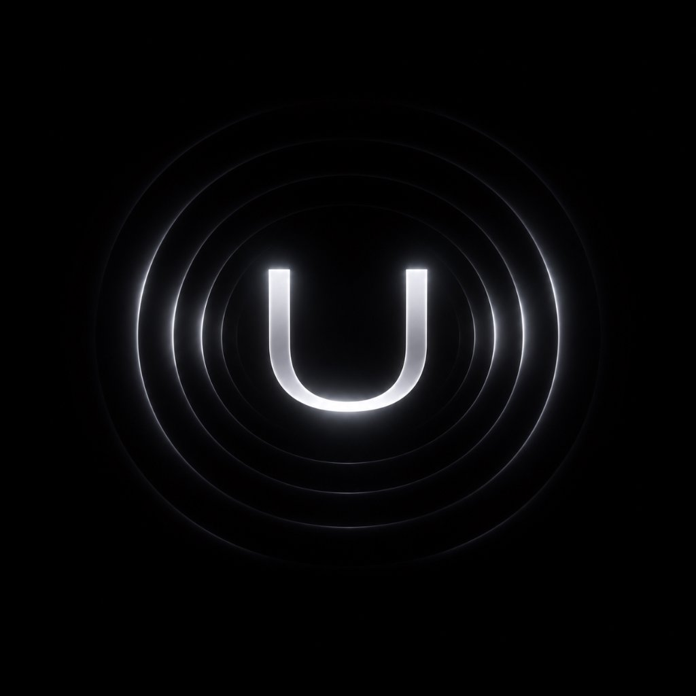
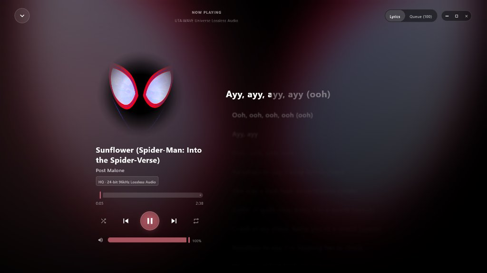
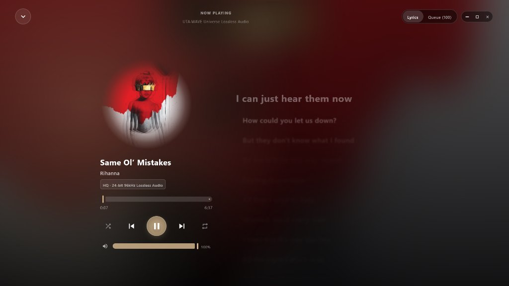
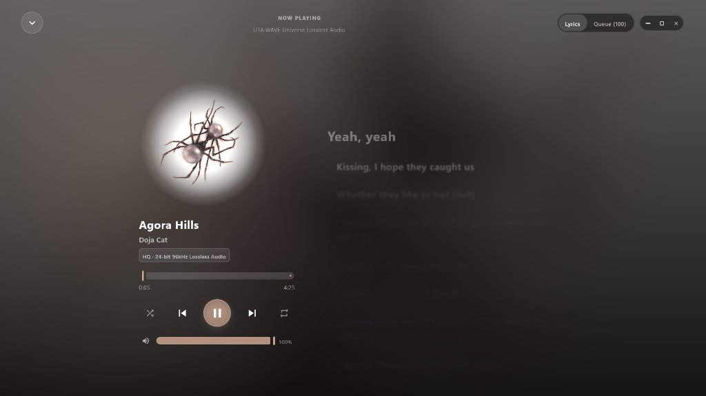
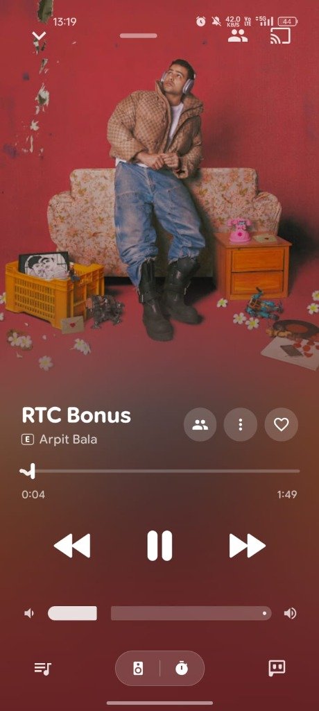
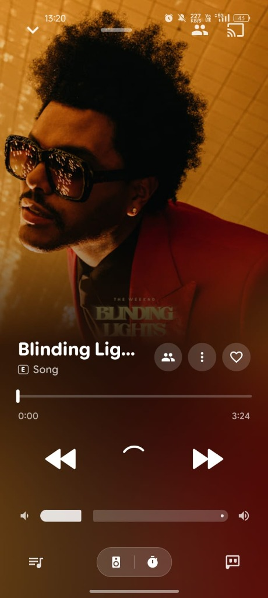
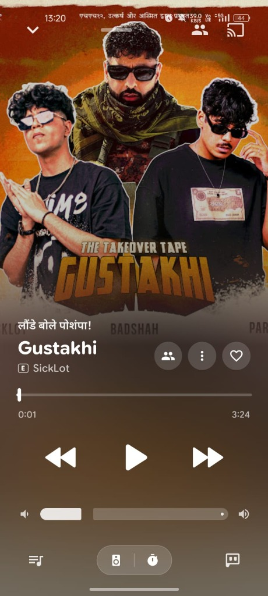
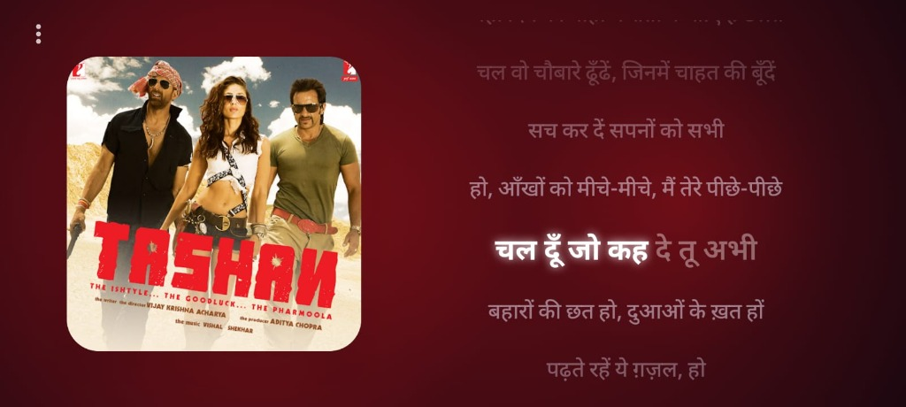
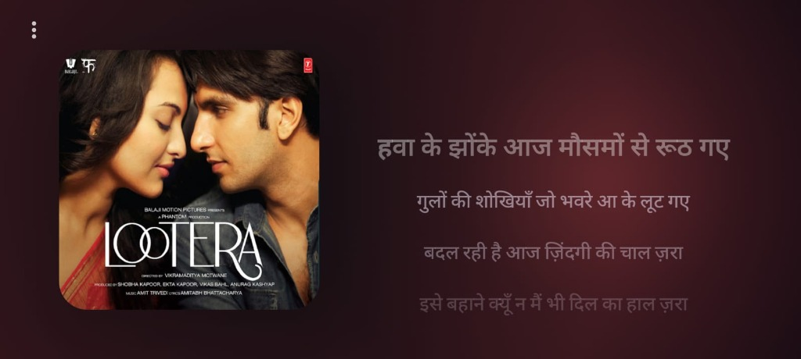

<div align="center">



# 🌊 UTA-WAVE
### *A Universe of Music — Cinematic, Ad-Free Music Streaming & Offline Audio Platform for Android & Windows Desktop*

[-F2AEC7?style=for-the-badge&logo=android&logoColor=black)](https://raw.githubusercontent.com/aftab125-del/UTA-WAVE/main/app-latest.apk)
[-0078D4?style=for-the-badge&logo=windows&logoColor=white)](https://github.com/aftab125-del/UTA-WAVE/releases/latest/download/UTA-wave-1.0.0.msi)
[](https://github.com/aftab125-del/UTA-WAVE/releases)

[](https://github.com/aftab125-del/UTA-WAVE)
[-7F52FF?style=flat-square&logo=kotlin&logoColor=white)](https://kotlinlang.org)
[](https://developer.android.com/jetpack/compose)
[](https://developer.android.com/guide/topics/media/media3)
[](https://developer.android.com/develop/ui/views/graphics/agsl)
[](https://www.instagram.com/dhaniya0patta?cplk=MWt5bWR4cXN1OTdqYg==)

<br/>

<p align="center">
  <b>UTA-WAVE</b> is an ultra-premium, dark, futuristic music streaming and offline playback platform engineered for audiophiles, aesthetic purists, and power users. Built on a clean <b>Kotlin Multiplatform (KMP)</b> architecture spanning <b>Android</b> and <b>Windows Desktop</b>, UTA-WAVE combines hardware-accelerated <b>AGSL liquid glass optics</b>, Apple Music-inspired fluid playback backdrops, synchronized kinetic typography lyrics, built-in acoustic song recognition, Windows 10/11 SMTC integration with Dynamic Island transport controls, and real-time cloud synchronization powered by Supabase.
</p>

---

</div>

## 📸 Visual Showcase

<div align="center">

### 💻 Windows Desktop Edition Experience

*Native Compose Desktop client with lossless 24-bit 96kHz playback, dual-column synchronized lyric canvas, and glass controls.*

| Sunflower (Post Malone) | Same Ol' Mistakes (Rihanna) | Agora Hills (Doja Cat) |
|:---:|:---:|:---:|
|  |  |  |

<br/>

---

### 📱 Android Mobile Experience

#### 1. Portrait Fullscreen Player

| Fluid Mesh & Squiggly Waveform | Amber Glow Control Deck | Dynamic Synchronized Lyrics |
|:---:|:---:|:---:|
|  |  |  |

<br/>

#### 2. Mobile Ambient Mode (Landscape)

*Rotate device for immersive, full-bleed kinetic typography with synchronized word-by-word karaoke glow.*

| Synchronized Devanagari Karaoke Lyrics (Tashan) |
|:---:|
|  |

| Cinematic Ambient Flow (Lootera) |
|:---:|
|  |

</div>

---

## ⚡ Quick Download & Installation

### 🤖 Android (Mobile & Tablet)
1. Download the latest release APK directly:
   👉 **[Download UTA-wave v1.1.10 APK](https://raw.githubusercontent.com/aftab125-del/UTA-WAVE/main/app-latest.apk)**
2. Open the downloaded file on your device and tap **Install** (enable *"Install unknown apps"* for your browser if prompted).
3. The app includes a built-in auto-updater that notifies you whenever a new release is available!

### 🖥️ Windows Desktop (Windows 10 & 11)
- **Installer (.msi)**:
  👉 **[Download UTA-wave Windows Installer (v1.0.0)](https://github.com/aftab125-del/UTA-WAVE/releases/latest/download/UTA-wave-1.0.0.msi)**
  *(Runs a per-user, single-click install with Desktop & Start Menu shortcuts)*
- **One-Click Portable Execution**:
  Clone or download this repository, then double-click [`run-desktop.bat`](run-desktop.bat) or run [`run-desktop.ps1`](run-desktop.ps1) for instant startup.

---

## ✨ Comprehensive Features

### 🖥️ 1. Windows Desktop Client (`:desktopApp`)
- **Compose Multiplatform UI**: Fully native Windows desktop client with dark glass styling, frameless fluid window controls, and responsive wide-screen layout.
- **Windows System Media Transport Controls (SMTC)**:
  - Deep integration with the Windows 10/11 taskbar media thumbnail, Lockscreen, and third-party overlays (e.g. **Dynamic Island**).
  - Real-time album artwork streaming via Windows StorageFile memory bridge.
  - Interactive transport controls: Play, Pause, Next, Previous, and Timeline seeking.
- **Native WMF AAC Streaming Engine**: Low-latency hardware-accelerated playback through JavaFX Media / Windows Media Foundation with automatic fallback proxy.
- **Floating Liquid Glass Navigation Bar**: Translucent glass pill floating seamlessly above content with active indicator glow.
- **Desktop Queue Management & Full-Bleed Lyrics**: Dedicated queue drawer with drag-drop style controls, quick song menus, and synchronized lyric backdrops.
- **Mobile-Desktop Cloud Sync**: Seamless account login syncing your playlists, favorites, and listening data in real time via Supabase.

---

### 🍎 2. Apple Music-Inspired Cinematic Player
- **Fluid Multi-Mesh Background**: Real-time atmospheric color mesh dynamically extracted from album cover palettes with smooth animated blur transitions.
- **Apple Control Deck**: Signature Apple-style fluid playback controls, progressive volume scrubbing, and output device switcher.
- **Turntable Vinyl Disc**: Rotating vinyl disc animation synchronized with playback state.
- **Squiggly & Custom Seek Bars**: Dynamic animated squiggly waveforms, continuous sleek lines, and haptic feedback scrubbing.
- **Gesture-Driven UX**: Swipe left/right across artwork or miniplayer to jump tracks; swipe down smoothly to collapse.

---

### 🔮 3. Liquid Glass & Physical Optics Engine
- **Hardware-Accelerated AGSL Shaders**: Physics-based ray refraction that dynamically bends and distorts live UI content behind floating navigation pills and docked players.
- **Chromatic Aberration**: 7-band rainbow spectral fringing along capsule contours for authentic glass realism.
- **Lens Geometry Controls**: Customizable curvature bevel height, signed-distance-field (SDF) displacement amount, and depth-of-field diffusion blur (10dp to 40dp).
- **Permanent Across UI**: Fully integrated into the **Floating MiniPlayer**, **Floating Navigation Bar**, and **Fullscreen Player Backdrops**.

---

### 🎙️ 4. Synchronized Karaoke & Kinetic Lyrics
- **Multi-Source Provider Hierarchy**: Real-time synced lyrics fetched from **LRCLIB**, **YouTube / Musixmatch**, and local LRC files.
- **Line-by-Line & Kinetic Word Animation**: Auto-scrolling lyrics with click-to-seek timestamp navigation and dynamic blur effects.
- **Multilingual & Devanagari Support**: Full support for Hindi, Japanese, Korean, Spanish, and English lyrics with flawless typography.
- **Mobile Ambient Mode**: Automatic horizontal orientation support transforming the phone into an ambient bedside or desk music clock with synchronized typography.

---

### 🎧 5. Audiophile Playback Engine
- **AndroidX Media3 ExoPlayer Architecture**: Foreground playback service (`WaveAudioService`) with full CPU wake-locks and Wi-Fi locks preventing background cutoff during Android Doze mode.
- **Native Media Notification & Lockscreen Player**:
  - High-res dynamic album artwork with color-matched background.
  - Interactive scrubbable progress bar with full media controls.
- **High-Resolution & Bit-Perfect USB DAC Mode**: Direct bit-perfect stream pass-through for external audiophile DACs.
- **Seamless Playback**: True gapless audio playback with customizable crossfade (0s - 10s) and skip silence detection.
- **10-Band Graphic Equalizer**: Custom parametric equalizer with Bass Boost and 3D Virtualizer processors.

---

### 🧠 6. AI Hub & Intelligent Music Studio
- **Google Gemini 2.0 Flash Integration**: Official free API key support delivering ultra-fast (< 1s) responses and structured JSON outputs.
- **BYO Key Provider Selector**: Seamless switching between **Google Gemini 2.0 Flash (Recommended)**, **OpenRouter (DeepSeek R1, GPT-4o, Claude 3.5)**, and a **Free Neural Cloud** fallback.
- **AI Playlist Studio Sandbox**:
  - Natural language prompt-to-playlist generator (*e.g. "Late night cyberpunk synth drive with female vocals"*).
  - Preset quick-mood chips (*Cyberpunk Drive*, *Rainy Day Acoustic*, *Tokyo City Pop*, *Intense Gym*, *Lo-Fi Focus*).
- **AI Lyrics Intelligence**: Real-time bilingual translation for foreign songs and phonetic romanization / transliteration.

---

### 🔍 7. Acoustic Song Recognition (Shazam DejaVu Engine)
- **Built-in Ambient Music Recognition**: Identify songs playing around you in seconds without third-party apps.
- **Native 16.0 kHz Acoustic Recording**: Captures audio directly at 16,000 Hz, eliminating software downsampling phase distortion.
- **Voice Recognition Audio Source**: Prioritizes `VOICE_RECOGNITION` and `UNPROCESSED` sources over standard `MIC`, preserving musical bass and overtones.
- **Pure-Kotlin DejaVu Implementation**: Reverse-engineered acoustic fingerprinting algorithm with 2048-point Hanning window FFTs and sub-bin quadratic interpolation.

---

### 📊 8. Listening Summary & Stats Center
- **Listening Analytics**: Track exact minutes listened today with trending pulse indicators.
- **Multi-Slot Time Selector**: Last 7 Days, Last 15 Days, Last 30 Days, and All-Time stats.
- **Visual Analytics**: 7-bar daily listening distribution charts, Most Played Song Spotlight, Top Artists Breakdown, and Sonic Vibe analysis.

---

### 📴 9. Complete Offline Mode & Download Manager
- **Zero-Network Library Resilience**: App opens instantly in offline / airplane mode without internet hangs, immediately presenting downloaded library tracks and playlists.
- **Multi-Quality Downloads**: Choose between Lossless Opus, High (256 kbps), and Standard (128 kbps).
- **Local Audio Player**: Scans and plays offline MP3/M4A/FLAC files directly from device storage.

---

### 🎨 10. Customization, Theming & Identity
- **Futuristic Brand Identity**: Concentric acoustic soundwaves with glowing white "U" on pure obsidian black.
- **Buttery-Smooth Launch**: High-performance GPU Canvas opening animation (~850ms, 120fps, zero GC allocations) with pitch-black cold-start window styling.
- **Theme Modes**: Obsidian Dark, True AMOLED Pitch Black, Clean Light, and Follow System.
- **Creator Attribution**: Dedicated header branding *"by Aftab Kathat"* on Home screen and interactive Instagram profile row in Settings.

---

## 🛠 Tech Stack & Architecture

```
UTA-WAVE Multiplatform Architecture
├── :core                 # Shared Kotlin Multiplatform data models, contracts, and Supabase cloud sync
├── :audio                # Audio interfaces, equalizer models, and stream management
├── :app                  # Android client (Jetpack Compose, Media3 ExoPlayer, AGSL shaders, Room)
└── :desktopApp           # Windows client (Compose Desktop, WMF audio engine, WinRT SMTC bridge)
```

| Component | Android Mobile | Windows Desktop |
|---|---|---|
| **Language** | Kotlin 2.0 (Strict Types) | Kotlin 2.0 (JVM 17) |
| **UI Toolkit** | Jetpack Compose / Material 3 | Compose for Desktop |
| **Audio Engine** | AndroidX Media3 (ExoPlayer 1.5) | JavaFX Media / Windows Media Foundation |
| **System Integration** | Android MediaSession & Notifications | Windows 10/11 SMTC & WinRT Interop |
| **Graphics & Optics** | AGSL RuntimeShaders & RenderEffect | Skiko Hardware Acceleration & Custom Shaders |
| **Lyrics Engine** | Synchronized LRCLIB / Kinetic Typography | Full-Bleed Dual-Column Kinetic Canvas |
| **Cloud Sync** | Supabase PostgreSQL & Realtime | Supabase Realtime Sync Engine |
| **Network & HTTP** | OkHttp 4.12 & Coroutines | OkHttp 4.12 & Coroutines |

---

## 🚀 Building from Source

### Prerequisites
- **JDK 17 or 21** (Eclipse Adoptium Temurin or JetBrains Runtime recommended)
- **Android Studio** Ladybug / Meerkat (for mobile module)
- **Android SDK 35/36** (`compileSdk 36`, `minSdk 26`, `targetSdk 36`)

### 1. Clone the Repository
```bash
git clone https://github.com/aftab125-del/UTA-WAVE.git
cd UTA-WAVE
```

### 2. Build Android APK
```bash
./gradlew :app:assembleDebug
# Output APK: app/build/outputs/apk/debug/app-debug.apk
```

### 3. Build & Run Desktop Client
```bash
# Run desktop client directly
./gradlew :desktopApp:run

# Package standalone executable UberJar
./gradlew :desktopApp:packageUberJarForCurrentOS

# Package Windows native installer (.msi)
./gradlew :desktopApp:packageMsi
```

---

## 👨‍💻 Creator & Community

**UTA-WAVE** is engineered and maintained with ❤️ by **Aftab Kathat**.

- 📸 **Instagram**: [@dhaniya0patta](https://www.instagram.com/dhaniya0patta?cplk=MWt5bWR4cXN1OTdqYg==)
- 🐙 **GitHub**: [@aftab125-del](https://github.com/aftab125-del)
- 🌐 **Project Home**: [https://github.com/aftab125-del/UTA-WAVE](https://github.com/aftab125-del/UTA-WAVE)

---

## 🔒 Privacy & Ad-Free Guarantee

- 🚫 **Zero Advertisements**: Absolutely no audio ads, banner ads, or tracking SDKs.
- 🚫 **No Commercial Telemetry**: Your data is yours; no behavioral analytics or tracking cookies.
- 💾 **Local-First & Private**: Playlists, cache, and history are stored on your device and private Supabase cloud backend.
- 🔑 **BYO API Keys**: AI features run directly using your personal Gemini or OpenRouter keys without intermediary proxies.

---

<div align="center">

*A Universe of Music — Welcome to the Wave.* 🌊

</div>
